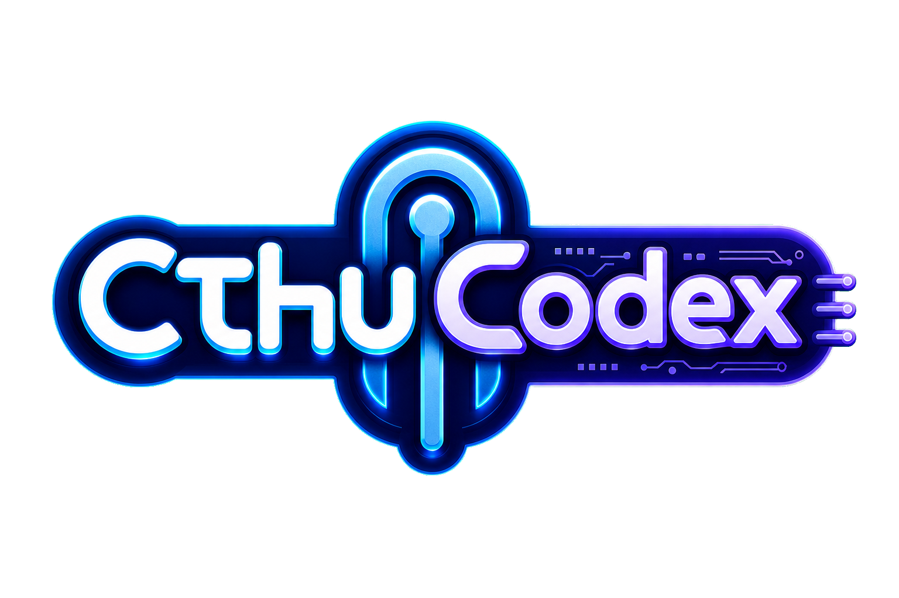

# CthuCodex

<p align="center">
  
</p>

Repository-managed Codex plugin for CthuTool workflows and reusable assistant
utilities.

User-facing plugin, Anki MCP, and skill documentation lives in the docs site:

- `apps/docs/src/content/docs/modules/codex-plugin.md`

## Local Install

From the repository root:

```bash
chc codex install
```

After install, start a new Codex thread or restart Codex so the bundled MCP
servers are loaded. In a fresh thread, use `/mcp` to verify the `anki` and
`language-feedback` servers are available.

## CthuTool CLI Skill

Use `$cthutool-cli` to operate or troubleshoot the installed `chc` CLI.
The automatically discoverable skill covers source selection/update, Agent
lifecycle, Codex skills/plugins, Obsidian agent links, bundled scripts, and
PowerShell/zsh completion. It uses live command help, JSON/non-interactive
operations where supported, and verification appropriate to the user's target.
Its workflow reference is bundled, so it works outside a CthuTool checkout.
After installing the updated plugin, start a fresh Codex thread to discover it.

## Language Feedback UI

The language coach still uses deterministic local filtering to decide whether
the latest prompt contains English prose. When coaching is active, the current
Codex model uses the read-only `cthu_language_feedback_present` tool before
starting the user's actual request, then completes the task and delivers the
main answer. The styled card is preferred whenever the tool is
available. MCP Apps-compatible hosts can render the result as an inline card
with the user's message, emphasized suggested wording, brief categorized notes,
and a local copy control. The full feedback is visible immediately. When the
wording is unchanged and there are no notes, the card shows only "Your message
is grammatically correct and sounds natural." Unchanged wording with optional
notes keeps the detailed view, labeled "No changes needed".

The component reports its content height through MCP Apps notifications and,
when available, `window.openai.notifyIntrinsicHeight`. Compatibility height
reporting works even when the host does not complete MCP Apps initialization.
The resource also sets the Codex-specific `openai/widgetMinFrameHeight` hint
to `0`; otherwise Codex can keep a 200px minimum despite smaller measurements.
This server metadata requires reloading the MCP server after an update; an
already running server can read new HTML while still returning old metadata.

Version `1` uses the `compact` variant and the resource URI
`ui://cthu-language-feedback/v1.html`. The versioned payload leaves room for
future presentation variants without moving correction generation into the
hook or MCP server. Clients that do not render MCP Apps still receive complete
standard text content. If the tool is unavailable or fails, the model is
instructed to put the same feedback in an English feedback section at the
beginning of the final answer, followed by the actual reply. The host controls
the exact placement of native tool cards.

The presentation server and component are local and read-only. They do not
call a model, load remote assets, send feedback over the network, persist
history or preferences, record telemetry, or mutate Anki. Copying uses only the
host's local clipboard capability when the user activates the control.

## Notion Libraries

Use `$notion-manage` explicitly to query, create, update, or reversibly remove
records in eleven personal Notion libraries: books, channels, comics, music releases,
movies, dramas, games, knowledge, documentaries, animation, and apps.

The entry point contains common CRUD rules and a library index. It reads only the
relevant `references/<library>.md`; Classical Work matching and music resolver notes
are loaded only when needed. People & Organizations is a shared relation reference;
authorized creation applies the person/band template and verifies its icon. Each reference retains its schema hints, identity rules,
and template/icon conventions. Live schema remains authoritative.

Creation uses available templates, verifies icons, and returns images for manual
addition. Clear requests authorize scoped operations; ambiguous destinations are
clarified. Implicit invocation is disabled. The former eleven `notion-manage-*`
entry points are replaced by this one skill, as are the earlier maintenance/add-only
entries. The optional music resolver remains skill-local.

## Source Boundary

Keep repository-owned plugin source, manifests, and implementation assets under
`codex/plugins/cthu-codex`. Keep generated command or skill adapters out of the
repository; regenerate them per tool or platform.

The project maintenance workflow `$codex-skill-promoter` lives in
`.agents/skills/codex-skill-promoter` and is discovered from a CthuTool
checkout. It is not bundled with this plugin or installed by
`chc codex install`. Selected promoted Skills still target this plugin.
See [AI tooling](../../../docs/ai-tooling.md#local-skill-promotion) for the
promotion lifecycle.

## TODO

- Integrate the future Notion Movie Library workflow with CthuTool's backend
  movie-metadata capability. Keep candidate disambiguation and user-authorized
  write scope; use the backend only as the metadata
  source.
